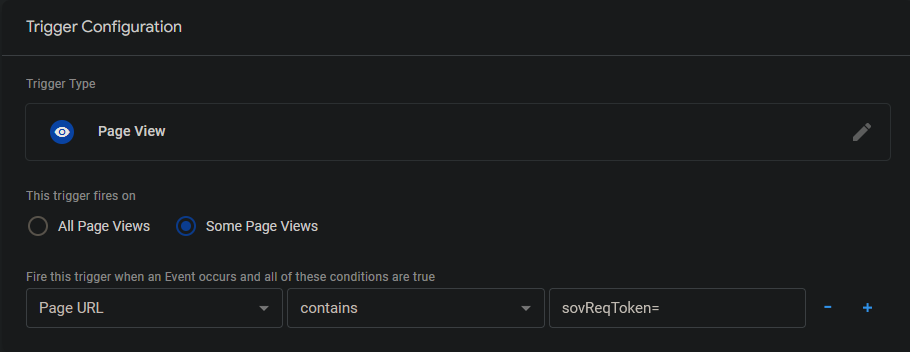
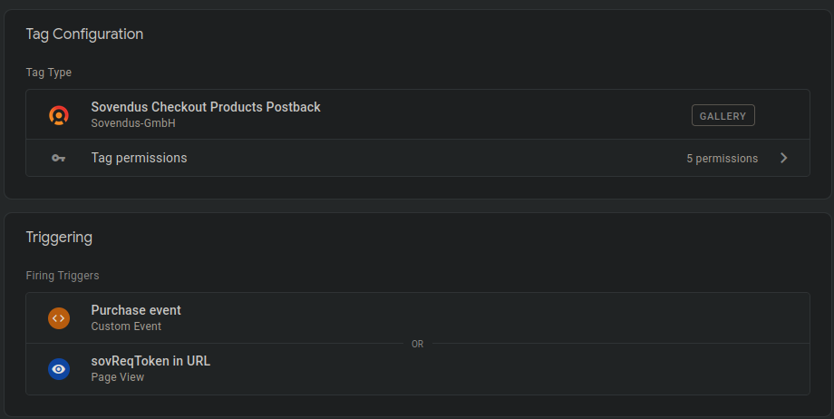

# Sovendus Checkout Products for Google Tag Manager

To setup Sovendus Checkout Products Postback, you need to create a tag in your GTM as described below.

## 🛠️ Add and setup the tag

1. Go to tags and create a new tag
2. Click on the first entry: "Discover more tag types in the Community Template Gallery"
3. Search for: "Sovendus Checkout Products Postback" and add it
4. Add a trigger which fires when the sovendus request token is in the url

   

5. Add a trigger which fires only on the order success page - e.g. your purchase event

6. The configuration should look similar to this

   
   
> [!WARNING]
> ** Optional **
> In addition to the above, you may also wish to store the sovReqToken alongside the order’s information - such as by sending the token to your backend - to persist it for a longer time. This way, you will be able to locate the token to be sent to Sovendus for cancellation purposes, if needed.
